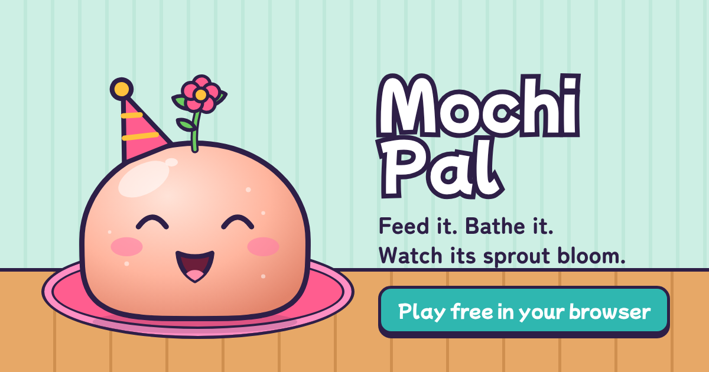

# Mochi Pal 🍙🌱

**Play it:** https://dilshanir.github.io/mochi-pal/



Raise Mochi, a squishy rice-cake pet with a sprout on its head. Feed it, bathe it, tuck it in,
play mini-games, and talk to it. It repeats what you say in a squeaky voice. Come back every day,
and the sprout grows from a tiny seedling into a glowing star flower.

Free, no ads, no account, and it works offline. Mochi lives in your browser.

## What's inside
- **A pet that feels alive:** jelly squash-and-stretch physics, eyes that follow your finger, blinking,
  breathing, 19 expressions, a sprout that sways after every bounce.
- **Care:** 4 needs (food, energy, fun, clean) that change in real time, even while you're away.
- **Touch:** boop the head, stroke to pet (hearts!), tickle the tummy, but don't poke too much.
- **Talk-back:** tap the mic and Mochi copies your voice. No mic? Type, and Mochi says it.
- **Bath time:** scrub on foam with the sponge, then rinse.
- **12 snacks** to unlock, some spicy. **9 hats and glasses, 9 fur colours** to try on and buy.
- **Mini-games:** Snack Catch, Vine Hop, and a dance party.
- **Daily reasons to return:** 7-day login calendar with a streak and Day-7 treasures, 3 daily
  quests and a bonus chest, a gift box every 3 hours, coins Mochi finds while you're away,
  and a room whose window follows your real time of day.
- **Growth:** Sprout → Seedling → Leafling → Budling → Blossom → Starbloom.
- **Installable app (PWA)**, backup codes to move Mochi between devices, Reduce motion option.

## Run it locally
```bash
npm run dev          # http://localhost:8080 (no install needed, Node 18+)
```
Any static server works. It must be served over http, because ES modules don't load from `file://`.

## Test it
```bash
npm install && npx playwright install chromium   # once
npm test             # plays the whole game headless on a phone screen; screenshots in tools/out/
npm run balance      # how many days each growth stage takes for light/casual/heavy players
```

## Deploy (GitHub Pages)
Settings → Pages → *Deploy from a branch* → `main` / `(root)`. Every push to `main` goes live
in about a minute. Bump `VERSION` in `sw.js` on each release so players get the new files.

## Build it further with Claude Code
- `CLAUDE.md`: architecture, rules and the definition of done (Claude Code loads it automatically).
- `PROMPTS.md`: ready-made, copy-paste feature prompts (sticker album, diary, Sri Lankan festival
  events, Sinhala & Tamil, friend visits, and more).
- Slash commands in `.claude/skills/`: `/add-content`, `/new-minigame`, `/juice-pass`,
  `/balance-check`, `/playtest`, `/ship`.

## Project layout
```
index.html          page shell + HUD markup
css/style.css       design tokens, sticker-toy look, time-of-day themes
js/main.js          wiring: input, actions, menus, retention loops
js/store.js         game state, saving + migration, all game rules
js/data.js          every number and piece of content (edit here to rebalance)
js/pet.js           Mochi: SVG drawing + spring animation + expressions
js/games.js         mini-games (canvas)
js/fx.js            particles, floating text, screen shake
js/sfx.js           synthesized sound effects (no audio files)
js/voice.js         talk-back voice changer (on-device)
sw.js               offline support
tools/              local server, playtest, balance checker
```

## Privacy
Nothing leaves your device. No analytics, cookies or network calls. Your pet is saved in this
browser's local storage. The microphone is used only while the mic button is on, and the audio is
processed in memory and never uploaded.

## Credits
- Mochi and all game art are original, drawn in code.
- Fonts: [Mochiy Pop One](https://github.com/fontdasu/Mochiypop) and
  [Zen Maru Gothic](https://github.com/googlefonts/zen-marugothic), SIL Open Font License 1.1
  (see `fonts/`), via Fontsource.
- `.claude/skills/game-feel`, `game-ui-ux`, `save-systems`, `audio-design`: from
  [awesome-gamedev-agent-skills](https://github.com/gamedev-skills/awesome-gamedev-agent-skills),
  Apache License 2.0, included unmodified with their LICENSE and NOTICE.
